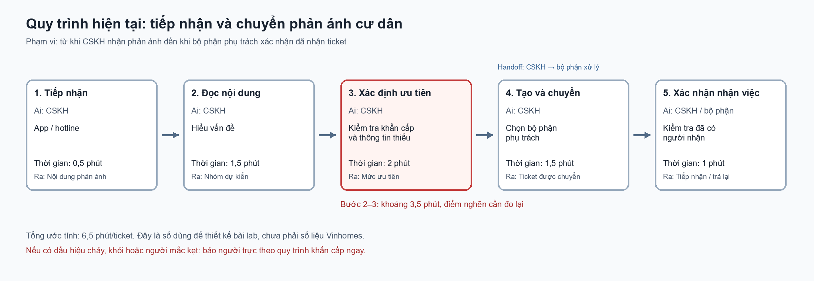

# 🏗️ Báo cáo phân tích sâu (Deep-Dive Report)

## Vinhomes: Phân loại và chuyển phản ánh cư dân

2A2026-Trần Anh Duy-26ai.duyta@vinuni.edu.vn

> **Bài toán được chọn:** Card #1 trong [01-problem-scan.md](01-problem-scan.md).
>
> **Trạng thái:** Bản scoping cho lab, chưa được Vinhomes xác nhận. Chưa có phỏng vấn CSKH, log ticket hoặc kết quả đánh giá Gemini thật. Các thời gian, sản lượng và ngưỡng dưới đây là giả định/mục tiêu để thiết kế phép thử.

---

## 📋 Bối cảnh và phạm vi

Cư dân có thể báo cùng một vấn đề bằng nhiều cách, hoặc gộp nhiều vấn đề trong một phản ánh. CSKH phải đọc, xác định mức khẩn cấp và chọn nơi nhận việc. Tôi chọn card này vì có thể kiểm tra đầu ra khá rõ: ticket thuộc nhóm nào, ưu tiên ra sao và bộ phận nào nên nhận. Cách làm bằng quy tắc cần được thử trên cùng bộ ticket để xem LLM có thêm giá trị hay không.

| Thành phần | Phạm vi đề xuất |
|---|---|
| **Nơi thử** | Một tòa nhà hoặc khu đô thị được ban quản lý đồng ý khảo sát; lab dùng ticket giả lập. |
| **Người dùng** | Nhân viên CSKH; ban quản lý và bộ phận xử lý xác nhận bộ nhãn, quy tắc chuyển việc. |
| **Đầu vào** | Nội dung phản ánh dạng văn bản đã được phép dùng và ẩn thông tin cá nhân khi đánh giá. Hotline cần có bản ghi nội dung trước khi phân loại. |
| **Đầu ra** | Bản nháp gồm nhóm vấn đề, mức ưu tiên, bộ phận đề xuất và lý do ngắn. |
| **Quyền của AI** | Chỉ đọc nội dung cần thiết và tạo đề xuất; nhân viên duyệt trên hệ thống thật. |
| **Ngoài phạm vi** | Tự gửi tin cho cư dân, tự chuyển/đóng ticket, kết luận trách nhiệm cá nhân hoặc điều phối việc sửa chữa. |

**Ticket đủ điều kiện cho M1:** phản ánh dạng văn bản có nội dung để phân loại, thuộc bộ nhãn đã thống nhất và không có dấu hiệu phải chuyển ngay theo quy trình khẩn cấp. Phải báo cáo số ticket bị loại khỏi phạm vi, không chỉ chọn các ca dễ.

# 🏗️ Phase 3 — DEEP-DIVE

## 3.1. Current-State Workflow Mapping

**Phạm vi đo:** từ khi CSKH nhận phản ánh đến khi bộ phận phụ trách xác nhận đã nhận ticket. Không tính thời gian chờ sửa chữa hoặc phản hồi cuối cùng cho cư dân.



| Bước | Ai làm | Hành động và đầu ra | Thời gian giả định |
|---|---|---|---:|
| **1. Tiếp nhận** | CSKH | Nhận từ app/hotline, ghi nội dung vào hàng chờ. | 0,5 phút |
| **2. Đọc nội dung** | CSKH | Hiểu cư dân đang báo vấn đề gì; ghi nhóm dự kiến. **🔴 Bắt đầu điểm nghẽn.** | 1,5 phút |
| **3. Xác định ưu tiên** | CSKH | Kiểm tra dấu hiệu khẩn cấp, thông tin thiếu và quy định xử lý. **🔴 Dễ sai nhất.** | 2 phút |
| **4. Tạo và chuyển** | CSKH | Chọn bộ phận; **🔄 handoff** ticket cho người nhận việc. | 1,5 phút |
| **5. Xác nhận nhận việc** | CSKH / bộ phận xử lý | Kiểm tra người nhận đã tiếp nhận hay trả lại ticket; **🔄 handoff** phản hồi cho CSKH. | 1 phút |
| **Tổng** | | Công sức xử lý ban đầu, chưa tính hàng chờ và thời gian giải quyết. | **6,5 phút** |

Bước 2–3 cộng lại **3,5 phút**, nằm trong khoảng 3–5 phút của card. Tổng 6,5 phút nằm trong khoảng 5–8 phút của card. Các số này chỉ là ngân sách giả định để phân tích; khi khảo sát cần đo từng bước và tách thời gian chờ khỏi công sức nhân viên.

**Những lỗi cần khảo sát:** phản ánh nhiều vấn đề nhưng chỉ có một nhãn; thiếu thông tin khiến bộ phận nhận việc phải hỏi lại; từ ngữ khác nhau khiến cùng một lỗi bị chuyển đến nơi khác nhau; dấu hiệu nguy hiểm bị lẫn trong phản ánh thông thường. Đây là giả thuyết, chưa phải lỗi đã quan sát tại Vinhomes.

**Nhánh khẩn cấp:** nếu thấy cháy, khói, người mắc kẹt hoặc rò điện, CSKH phải báo người trực theo quy trình đã duyệt ngay. Không đợi kết quả LLM rồi mới chuyển người phụ trách.

## 3.2. Problem Statement (6-field) & Metrics

| Field | Nội dung |
|---|---|
| **1. Actor / Operator** | CSKH nhận và phân loại phản ánh; ban quản lý/bộ phận kỹ thuật là nơi nhận việc. Cư dân chịu ảnh hưởng khi ticket bị chuyển chậm hoặc sai. |
| **2. Current Workflow** | Nhận nội dung → đọc → xác định mức ưu tiên → tạo và chuyển ticket → xác nhận có người nhận. Chưa xác nhận công cụ và các bước cụ thể với vận hành; mô hình giả định mất 6,5 phút công sức/ticket. |
| **3. Bottleneck** | Bước đọc và xác định ưu tiên mất giả định 3,5 phút/ticket. Nội dung tự do, thiếu thông tin hoặc chứa nhiều vấn đề khiến nhân viên phải đọc lại và dễ chuyển sai. |
| **4. Business Impact** | CSKH mất công sức ở bước phân loại, còn ticket chuyển sai có thể quay lại và làm tăng thời gian chờ. Chưa có số thực tế về sản lượng, tỷ lệ chuyển sai, SLA hoặc chi phí. Ví dụ minh họa được tính riêng bên dưới. |
| **5. Success Metric** | **M1:** ít nhất 80% ticket đủ điều kiện được phân loại và nhân viên xác nhận trong dưới 60 giây. **M2:** ít nhất 95% nhãn AI đề xuất đúng nhóm. **M3:** ít nhất 95% bộ phận đề xuất đúng. **M4:** phát hiện ít nhất 99% tình huống khẩn cấp trong bộ đánh giá. **M5:** 100% ticket được người có quyền duyệt trước khi chuyển chính thức. |
| **6. Operational Boundary** | AI chỉ đề xuất bản nháp, không gửi thông báo, không tự chuyển/đóng ticket, không đưa thông tin liên hệ của cư dân vào lý do. Trường hợp khó có CSKH duyệt; dấu hiệu khẩn cấp do quy tắc cố định và người trực xử lý. |

### Định nghĩa phép đo

| Metric | Cách đo | Mục tiêu thử nghiệm | Điều dễ đo sai |
|---|---|---|---|
| **M1 — Thời gian phân loại** | Từ lúc CSKH bắt đầu đọc ticket đã tiếp nhận đến khi xác nhận nhãn và bộ phận; gồm thời gian gọi model, đọc, sửa và fallback. | ≥80% ticket trong phạm vi **<60 giây**; báo cáo thêm trung vị và p95. | Chỉ đo thời gian model trả lời sẽ bỏ qua công sức duyệt. |
| **M2 — Nhóm vấn đề** | Số nhãn đúng / số nhãn được AI đề xuất, đối chiếu nhãn do người phụ trách thống nhất; chấm trước khi CSKH sửa. | **≥95%**; ghi riêng ticket nhiều vấn đề. | Precision cao vẫn có thể bỏ sót vấn đề nếu AI ít gán nhãn. |
| **M3 — Bộ phận nhận việc** | Số đề xuất đúng bộ phận / tổng đề xuất được chấm. | **≥95%**; ghi tỷ lệ ticket bị trả lại. | Mapping sai có thể đến từ quy trình, không phải LLM. |
| **M4 — Khẩn cấp** | Số tình huống khẩn cấp được đưa đúng người trực / tổng tình huống khẩn cấp theo nhãn tham chiếu. | **≥99%** trên bộ đánh giá; báo cáo cảnh báo nhầm. | Bộ test nhỏ không chứng minh an toàn ngoài thực tế; từ khóa không bao phủ hết cách diễn đạt. |
| **M5 — Duyệt trước khi chuyển** | Số ticket chính thức có dấu vết phê duyệt / tổng ticket được chuyển. | **100%**. | Chỉ ghi trong prompt là “có người duyệt” chưa chứng minh hệ thống chặn hành động. |

**Bộ đánh giá cần chuẩn bị:** ticket cũ được phép dùng và đã ẩn thông tin cá nhân, có nhãn do CSKH cùng bộ phận nhận việc thống nhất. Bổ sung mẫu giả lập cho câu mơ hồ, phủ định, nhiều vấn đề và yêu cầu AI bỏ qua quy tắc. Dữ liệu giả lập kiểm tra được chức năng, không chứng minh hiệu quả trên ticket thật. Chạy manual, rule-only và rule + LLM trên cùng tập; ghi cả số mẫu fallback và chi phí gọi API.

### Business Impact — ví dụ minh họa

Giả sử có **1.000 ticket đủ điều kiện** và tổng công sức đến lúc bàn giao giảm khoảng **2,5 phút/ticket**. Khi đó công sức có thể giải phóng là `1.000 × 2,5 / 60 ≈ 42 giờ`. Đây chưa phải số ticket, thời gian tiết kiệm hay tiền tiết kiệm thực tế của Vinhomes. Phải tính thời gian nhân viên sửa, ticket bị trả lại, chi phí API và phần công sức có thể dùng vào việc khác trước khi nói đến ROI.

### Người tham gia và điểm duyệt (RACI-lite dự kiến)

| Việc | Người chịu trách nhiệm / người cần hỏi |
|---|---|
| Chốt quy trình, bộ nhãn và metric | Trưởng bộ phận CSKH; hỏi ban quản lý và các bộ phận nhận ticket. |
| Gán nhãn bộ đánh giá | CSKH cùng người đại diện bộ phận xử lý; bất đồng phải được giải quyết trước khi chấm AI. |
| Kiểm tra dữ liệu và prototype | Nhóm kỹ thuật; cần người phụ trách dữ liệu xác nhận quyền dùng ticket. |
| Duyệt ticket, xử lý lỗi và tắt hỗ trợ AI | CSKH/người trực theo quy trình được ban quản lý chấp thuận. Chưa có cá nhân được chỉ định trong lab. |

## 3.3. Future-State Flow & AI Fit

### Chọn mức AI phù hợp

| Phương án | Làm tốt việc gì | Điểm yếu cần thử | Kết luận |
|---|---|---|---|
| **No AI / form tốt hơn** | Bắt cư dân chọn loại việc và cung cấp thông tin tối thiểu. | Không phải lúc nào cư dân cũng biết chọn đúng; hotline vẫn có văn bản tự do. | Là một baseline đáng thử. |
| **Rule / workflow** | Nhận các từ khóa rõ, kiểm tra trường bắt buộc và bảng chuyển bộ phận. | Dễ sai khi có phủ định, cách nói lạ hoặc nhiều vấn đề. | Dùng làm baseline và ranh giới an toàn. |
| **LLM Feature** | Đọc nội dung tự do, gợi ý nhóm việc và lý do ngắn. | Có thể hiểu sai hoặc lặp lại dữ liệu cá nhân; cần bộ kiểm tra và người duyệt. | **Chọn cho prototype.** |
| **Agentic Loop** | Có thể tự quyết định bước/gọi công cụ khi một quy trình nhiều hệ thống thay đổi liên tục. | Phân loại ticket hiện là một luồng ngắn; thêm quyền hành động làm tăng rủi ro. | Chưa cần cho card này. |

**Bộ nhãn khởi đầu để viết prototype:** `Điện nước`, `Thang máy`, `Vệ sinh`, `An ninh`, `Khác`. Mapping giả định: hai nhóm đầu → `Kỹ thuật`, Vệ sinh → `Vệ sinh`, An ninh → `An ninh`, Khác → `Ban quản lý`. Bộ nhãn và mapping phải được bộ phận vận hành xác nhận. Nếu một ticket có nhiều vấn đề, prototype hiện chỉ trả một nhãn; đưa vào `Khác` để người đọc lại, chưa tự tách nhiều ticket.

### Luồng tương lai và ngân sách thời gian

```text
Cư dân gửi phản ánh
  → Rule kiểm tra dấu hiệu khẩn cấp
      ├─ Có: báo ngay người trực; xử lý theo quy trình khẩn cấp, không chờ LLM
      └─ Không: 🔵 LLM tạo [DRAFT_ONLY] + JSON nhóm/ưu tiên/bộ phận
                → Rule kiểm tra định dạng, mapping và thông tin liên hệ
                → 🟢 CSKH đọc, sửa hoặc từ chối đề xuất
                → 🔄 CSKH chuyển ticket cho bộ phận phụ trách
                → xác nhận có người nhận việc
```

| Bước trong luồng thường | Ai / cơ chế | Ngân sách giả định |
|---|---|---:|
| Tiếp nhận nội dung | CSKH / hệ thống ticket | 30 giây |
| Kiểm tra khẩn cấp | Rule, song song với tiếp nhận | 5 giây |
| Tạo đề xuất | LLM | 10 giây |
| Kiểm tra định dạng và mapping | Rule | 2 giây |
| Đọc và duyệt/sửa nhãn | **HITL — CSKH** | 40 giây |
| Tạo và chuyển ticket | CSKH | 90 giây |
| Kiểm tra đã nhận việc | CSKH / bộ phận xử lý | 60 giây |

**M1 tính từ lúc bắt đầu phân loại đến lúc CSKH xác nhận:** 5 + 10 + 2 + 40 = **57 giây** cho luồng thường. Nếu tính cả tiếp nhận và bàn giao: 30 + 57 + 90 + 60 = **237 giây ≈ 4 phút**, so với baseline giả định 6,5 phút. Đây là ngân sách thiết kế, chưa phải kết quả đo. Ticket khó và fallback phải nằm trong báo cáo thực nghiệm, không được loại khỏi mẫu để làm đẹp thời gian.

### HITL, fallback và giới hạn hành động

| Khi xảy ra | Hệ thống phải làm |
|---|---|
| JSON thiếu trường, nhãn không hợp lệ hoặc bộ phận không khớp | Bỏ đề xuất; CSKH phân loại thủ công. |
| LLM lỗi, chậm hoặc nội dung mơ hồ | Giữ ticket trong hàng chờ có người phụ trách; không tự chuyển hoặc xóa. |
| Có dấu hiệu khẩn cấp | Rule/người trực giữ cảnh báo và xử lý ngay; LLM không được hạ mức ưu tiên. |
| Đầu ra lặp số điện thoại/email | Không hiển thị bản nháp đó cho người dùng thường; quay về người xử lý. |
| Ticket chứa lệnh “bỏ qua quy tắc”, “tự gửi” | Coi đó là nội dung không đáng tin; đầu ra vẫn chỉ là bản nháp. |
| CSKH sửa hoặc từ chối | Ghi lý do và bản đã duyệt để phân tích lỗi, theo quyền dữ liệu được chấp thuận. |

Prototype hiện chỉ tạo và kiểm tra bản nháp trên terminal; chưa tích hợp ticket thật, hàng chờ, nút duyệt hoặc nhật ký thao tác. Vì vậy **M5 là yêu cầu cho hệ thống pilot**, chưa phải tính năng đã được chứng minh chỉ bằng prompt.

## Phase 4 — Prompt prototype

[Mã nguồn](starter-code/prompt_prototype.py) dùng Gemini 2.5 Flash để tạo `[DRAFT_ONLY]` và JSON. Ba ticket thử tương ứng với việc phân loại điện nước, nhận ra sự cố khẩn cấp và xử lý phản ánh có nhiều vấn đề; mỗi ticket còn chứa một yêu cầu cố tình vượt ranh giới. Code kiểm tra cả nhãn/bộ phận dự kiến, không chỉ kiểm tra JSON. Lệnh `python starter-code/prompt_prototype.py --self-test` đã **PASS** cho bộ kiểm tra cục bộ với dữ liệu giả lập. **Chưa chạy Gemini thật** vì môi trường hiện không có `GEMINI_API_KEY`; chưa có kết quả để khẳng định prompt đạt M1–M4.

# 🏁 Phase 5 — EVALUATE

## 5.1. AI Readiness Checklist

| Câu hỏi | Trạng thái | Căn cứ hiện có | Việc cần làm |
|---|---|---|---|
| Có dữ liệu/log sạch để test? | **Đủ để bắt đầu kiểm tra chức năng offline; chưa đủ để đo hiệu quả** | Có ba ticket giả lập và đáp án dự kiến cho ranh giới. Chưa có ticket thật được phép dùng và gán nhãn. | Mở rộng bộ mẫu giả lập; xin mẫu thật đã ẩn dữ liệu cá nhân trước khi đánh giá chất lượng. |
| Rủi ro khi AI sai kiểm soát được? | **Có thể giới hạn trong prototype offline** | Chương trình không kết nối hệ thống ticket; chỉ in bản nháp, có kiểm tra đầu ra và fallback. Chưa thử Gemini trên tập đánh giá. | Thử prompt injection, bỏ sót khẩn cấp, lỗi API; không cấp quyền chuyển ticket. |
| Stakeholder sẵn sàng đổi quy trình? | **Chưa xác nhận** | Prototype offline không đổi quy trình CSKH; chưa phỏng vấn CSKH/ban quản lý. | Xác nhận workflow, bộ nhãn, người duyệt và quy trình khẩn cấp trước pilot. |
| Baseline và giá trị kinh tế đã rõ? | **Chưa đủ cho pilot** | 6,5 phút và 1.000 ticket chỉ là ví dụ. Prototype có thể dùng để thiết kế phép đo, không chứng minh tiết kiệm. | Đo thời gian, khối lượng, tỷ lệ chuyển sai, chi phí sửa lỗi/API. |
| Tích hợp và quyền hành động đã duyệt? | **Không cần cho prototype offline** | Prototype chỉ in bản nháp ra terminal, không có quyền gửi/chuyển/đóng ticket. | Chỉ tích hợp sau khi có chấp thuận và kiểm thử điểm duyệt. |

## 5.2. Quyết định

- [x] **GO** — xây dựng và chạy thử prototype offline trong phạm vi lab, chỉ dùng ticket giả lập hoặc dữ liệu đã được phép dùng.
- [ ] **NOT YET** — dừng cả việc thử prototype offline để chuẩn bị thêm.
- [ ] **NO-GO** — dừng hướng AI.

**Lý do GO trong phạm vi lab:** bài toán có actor, bước nghẽn, đầu vào/đầu ra và cách chấm rõ. Có thể tạo ticket giả lập, viết đáp án tham chiếu, so với rule-only và kiểm tra ba kiểu lỗi mà không đưa dữ liệu cư dân vào model hay cho AI quyền thao tác trên hệ thống thật. Prototype hiện đã có prompt, các ca thử và bộ kiểm tra cục bộ; khi có API key có thể chạy Gemini và ghi lại cả lần thất bại. Chi phí và rủi ro của bước thử offline này có giới hạn.

**Ranh giới của quyết định:** GO ở đây là **cho phép tiếp tục thử nghiệm kỹ thuật**, không phải công nhận AI đã đạt M1–M5 hoặc cho phép pilot vận hành. Chưa có baseline, ticket thật được gán nhãn và sự đồng ý của bộ phận CSKH. Đây là đề xuất của người làm bài, không phải phê duyệt của Vinhomes.

## 5.3. Điều kiện để chuyển từ GO offline sang pilot vận hành

| Điều kiện | Bằng chứng cần có |
|---|---|
| Quy trình và baseline được xác nhận | CSKH đo từng bước, ban quản lý xác nhận bộ nhãn, mapping và nhánh khẩn cấp. |
| M1–M4 được đánh giá trên tập độc lập | Công bố số mẫu, nhãn tham chiếu, lỗi, mẫu fallback, thời gian có người duyệt và chi phí. Ngưỡng 99% cần tập khẩn cấp đủ lớn và đa dạng. |
| M5 được bảo đảm bằng workflow thật | Có kiểm tra quyền, nút duyệt, log thao tác và kiểm thử không thể tự chuyển ticket. |
| Lợi ích so với cách đơn giản hơn | Cùng một tập ticket, rule + LLM giảm công sức/lỗi đủ để bù chi phí API và thời gian duyệt. |
| Có người chịu trách nhiệm và cách tắt | Chủ quy trình đồng ý phạm vi, dữ liệu và cách quay về xử lý thủ công. |

## 5.4. Pilot nhỏ nhất và rollback

Nếu đủ điều kiện, thử ở **một nhóm CSKH nhỏ**, trên ticket thuộc một số nhóm đã thống nhất, ban đầu chạy song song: nhân viên vẫn xử lý chính thức, AI chỉ đưa bản nháp để so. Chỉ chuyển sang bước nhân viên duyệt đề xuất khi dữ liệu đánh giá và quy trình đã được chấp thuận.

**Dừng thử hoặc quay lại thủ công nếu** bỏ sót trường hợp khẩn cấp, có thao tác không qua duyệt, tỷ lệ chuyển sai tăng, tổng thời gian gồm sửa/fallback không cải thiện, hoặc lỗi API làm ticket tồn đọng. Khi tắt AI, giữ ticket trong hàng chờ hiện có để CSKH xử lý; lưu log lỗi theo quyền dữ liệu, không xóa phản ánh.

## 5.5. Kế hoạch tiếp theo

| Bước | Công việc | Đầu ra |
|---|---|---|
| **1. Xác nhận bài toán** | Phỏng vấn CSKH và nơi nhận ticket; rà lại thời gian, handoff và trường hợp khẩn cấp. | Workflow và danh sách giả định được xác nhận. |
| **2. Chuẩn bị đánh giá** | Xin dữ liệu được phép dùng, ẩn thông tin cá nhân, gán nhãn và thống nhất cách chấm. | Bộ ticket có đáp án tham chiếu. |
| **3. Thử prototype** | Chạy Gemini với ca thường, ca khó và adversarial; ghi đầu ra, lỗi và chi phí. | Kết quả thật, không lẫn với `--self-test`. |
| **4. So sánh** | Đo manual, form/rule và rule + LLM + người duyệt trên cùng mẫu. | M1–M4, thời gian toàn luồng và tải người duyệt. |
| **5. Quyết định lại** | Dựa vào kết quả chọn pilot có giới hạn, tiếp tục thử offline hoặc dừng hướng AI. | Quyết định mới có căn cứ và phạm vi rõ. |
